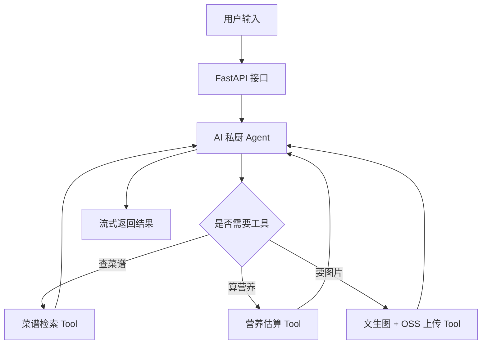

# 🍳 AI 私人厨师（AI Private Chef）

> 基于 LangChain 构建的对话式菜谱助手：告诉它你有什么食材、口味和饮食目标，它会推荐菜谱、估算营养，还能生成菜品图片。


## 项目简介

AI 私人厨师是一个基于大语言模型（LLM）的 Agent 应用。相比"一问一答"的聊天机器人，它具备：

- **工具调用能力**：自动决定何时查询菜谱、何时计算营养、何时生成菜品图片
- **多轮记忆**：记住你的口味偏好、忌口和历史对话
- **流式输出**：边生成边返回，交互更自然
- **可观测性**：接入 LangSmith，全链路追踪每次模型思考与工具调用


## 功能特性

| 功能 | 说明 |
|------|------|
| 🥬 食材菜谱推荐 | 输入现有食材，推荐可做的菜 |
| 🌶️ 个性化口味 | 支持辣度、忌口、饮食目标（减脂 / 增肌 / 清淡） |
| 🔥 营养估算 | 估算菜品热量与主要营养素 |
| 🖼️ 菜品图片生成 | 调用文生图模型生成菜品图，上传 OSS 返回图片链接 |
| 💬 多轮对话 | 基于 `thread_id` 维护会话记忆 |
| ⚡ 流式响应 | SSE 流式返回，打字机效果 |
| 🔍 全链路追踪 | LangSmith 记录模型调用、工具执行与耗时 |

## 技术栈

- **语言**：Python 3.10+
- **Agent 框架**：LangChain 1.x（create_agent / Runtime / Middleware）
- **模型服务**：阿里云百炼（通义千问）/ DeepSeek / Ollama（本地）
- **Web 服务**：FastAPI + Uvicorn
- **可观测性**：LangSmith
- **对象存储**：阿里云 OSS
- **图片生成**：通义万相（wanx）

## 项目结构

```
ai-private-chef/
├── app/
│   ├── main.py              # FastAPI 入口，路由与流式响应
│   ├── agent.py             # Agent 组装：模型、工具、中间件、记忆
│   ├── config.py            # 环境变量与全局配置
│   ├── schemas.py           # 请求 / 响应数据模型
│   └── tools/
│       ├── recipe.py        # 菜谱检索工具
│       ├── nutrition.py     # 营养 / 热量估算工具
│       └── image.py         # 菜品图片生成 + OSS 上传
├── static/                  # 前端页面
├── tests/                   # 单元测试
├── .env.example             # 环境变量模板
├── requirements.txt
└── README.md
```

## 快速开始

### 1. 克隆并安装依赖

```bash
git clone https://github.com/<your-username>/ai-private-chef.git
cd ai-private-chef

python -m venv .venv
# Windows
.venv\Scripts\activate
# macOS / Linux
source .venv/bin/activate

pip install -r requirements.txt
```

### 2. 配置环境变量

复制 `.env.example` 为 `.env`，填写自己的密钥：

```bash
# Windows
copy .env.example .env
# macOS / Linux
cp .env.example .env
```

`.env.example` 内容：

```ini
# ===== 大模型 =====
DASHSCOPE_API_KEY=your_dashscope_api_key
MODEL_NAME=qwen-plus

# ===== LangSmith =====
LANGCHAIN_TRACING_V2=true
LANGCHAIN_API_KEY=your_langsmith_api_key
LANGCHAIN_PROJECT=ai-private-chef

# ===== 阿里云 OSS =====
OSS_ACCESS_KEY_ID=your_access_key_id
OSS_ACCESS_KEY_SECRET=your_access_key_secret
OSS_ENDPOINT=oss-cn-hangzhou.aliyuncs.com
OSS_BUCKET=your_bucket_name

# ===== 图片生成 =====
IMAGE_MODEL=wanx2.1-t2i-turbo
```

> ⚠️ `.env` 已加入 `.gitignore`，请勿提交到仓库。

### 3. 启动服务

```bash
uvicorn app.main:app --reload --port 8000
```

- 接口文档：http://localhost:8000/docs
- 前端页面：http://localhost:8000

## 使用示例

**请求**

```bash
curl -X POST http://localhost:8000/api/chat \
  -H "Content-Type: application/json" \
  -d "{\"message\": \"冰箱里有鸡胸肉、西兰花和两个鸡蛋，想做个减脂晚餐\", \"thread_id\": \"user-001\"}"
```

**响应（流式）**

```
根据你现有的食材，推荐一道「西兰花鸡胸肉炒蛋」：
- 做法：鸡胸肉切丁腌制 10 分钟，西兰花焯水，先炒蛋再合炒
- 预计热量约 380 kcal，蛋白质约 42g
图片已生成：https://your-bucket.oss-cn-hangzhou.aliyuncs.com/dishes/xxx.png
```

## Agent 工作流程



**设计说明**

- **为什么用 Agent 而不是固定工作流**：用户意图不确定（可能只要菜谱，也可能要图片 + 营养），交给模型自主决定调用哪些工具更灵活
- **记忆策略**：短期记忆用 checkpointer + `thread_id` 隔离会话；历史过长时做裁剪 / 摘要，控制 Token 成本
- **可观测性**：开启 LangSmith 后，每次请求都能看到完整调用链、工具入参出参和耗时，便于定位问题

## API 说明

| 方法 | 路径 | 说明 |
|------|------|------|
| POST | `/api/chat` | 非流式对话 |
| POST | `/api/chat/stream` | SSE 流式对话 |
| GET | `/health` | 健康检查 |

请求体：

```json
{
  "message": "今晚想吃什么？",
  "thread_id": "user-001"
}
```

## 常见问题

| 问题 | 排查方向 |
|------|----------|
| 401 / 403 | 检查 `.env` 中的 API Key 是否正确、是否过期 |
| 图片链接打不开 | 检查 OSS Bucket 权限（公共读）与 Endpoint 区域 |
| 流式输出无响应 | 检查前端是否以 `text/event-stream` 接收；确认未被代理缓冲 |
| LangSmith 无记录 | 确认 `LANGCHAIN_TRACING_V2=true` 且 Key 正确 |
| 回答很慢 | 换更小的模型；减少工具数量；开启流式输出 |

## 后续可扩展

- [ ] 冰箱食材识别（拍照 → 多模态模型）
- [ ] 生成一周食谱与采购清单
- [ ] 对接生鲜电商 API，一键加购
- [ ] 用户偏好持久化到数据库（长期记忆）
- [ ] 多智能体：营养师 + 厨师 + 采购助手协作

